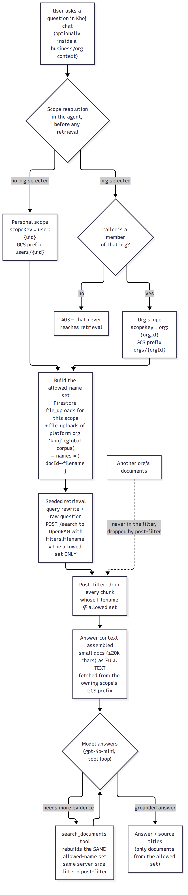
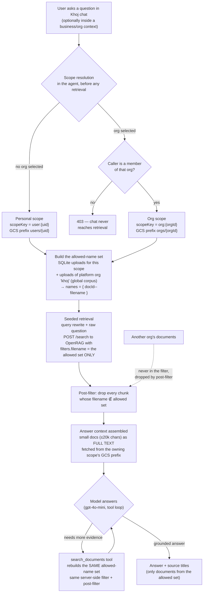

# Khoj — How Chat Is Isolated per User and per Org

*Nov 3, 2026 · applies to the single-stack build (`3eed4af`): Khoj UI/agent on top of the GKE OpenRAG engine.*

## The one idea everything hangs on

OpenRAG has **one shared index** and no per-user security inside it. Khoj creates the boundary
*outside* OpenRAG, from a naming convention:

- Every uploaded file is ingested into OpenRAG under the name **`{docId}--{filename}`**,
  where `docId = doc-` + first 24 hex chars of `sha256("{scope}/{filename}")`
  and `scope` is `users/{uid}` for a personal corpus or `orgs/{orgId}` for a business corpus.
- The same name can therefore never collide across users, and every chunk in the index
  carries its owner's scope inside its filename.
- Khoj keeps the upload records (SQLite `uploads`: docId, filename, scope) and, for
  every chat, builds the **exact set of OpenRAG names the caller is allowed to see** — their
  own scope's names **plus the global corpus** (documents of the platform org `khoj`, visible
  to everyone by design). Another org's names are never in the set.
- Every retrieval — the seeded search *and* every tool search during the answer — is
  (a) sent to OpenRAG with a **server-side filename filter naming exactly that set**, and
  (b) **post-filtered** in Khoj: any chunk whose filename is not in the set is dropped before
  the model can see it. Defence in depth: even if the engine returned a foreign chunk, it
  would not reach the prompt.

## Flow diagram

## Step by step

1. **Scope resolution (before retrieval).** A chat request carries an optional `orgId`.
   Without one, the scope is the caller's personal corpus. With one, the agent checks org
   membership in SQLite first — a non-member gets a 403 and no search ever runs.
2. **Allowed-name set.** The agent reads the scope's upload records and the platform org's
   records and turns them into OpenRAG filenames. This set is the entire security boundary,
   computed fresh on every request (and again on every tool call).
3. **Seeded retrieval.** The question is rewritten into a keyword query by the model; both
   the rewrite and the raw question are searched, results merged and deduped. Each `POST /search`
   carries `filters: {"filename": [allowed names]}` so OpenRAG itself only scans the caller's
   chunks plus the global corpus.
4. **Post-filtering.** Returned chunks are checked against the allowed set a second time,
   inside the agent. Chunks with empty text (below-relevance "shell hits") are also dropped.
5. **Answer context.** Chunks are grouped per document (best first, caps per doc and overall).
   Documents whose full text is ≤ 20,000 characters are handed to the model as complete text
   (fetched from GCS under the *owning scope's* prefix) — this is what makes form-like PDFs
   (W-2s, statements) answerable, because their chunks interleave glossaries with values.
6. **Tool loop.** The model (gpt-4o-mini — the same model OpenRAG's own chat uses) may call
   `search_documents` up to 3 times with its own keyword queries. The tool rebuilds the same
   allowed-name set and applies the same two filters, so iteration can never widen the corpus.
7. **Answer.** Grounded answer with citations; sources listed are titles from the allowed set
   only. A first-pass refusal triggers one firmer re-read. If the model is unavailable, an
   extractive fallback quotes sections of the caller's own source files — same boundary,
   because it reads only the scope's GCS prefix.

## What this guarantees — and what it doesn't

| Guarantee | How |
|---|---|
| Org A never sees Org B's documents in chat | B's names are never in A's filter; post-filter drops strays; membership 403 before retrieval |
| A user never sees another user's documents | Personal scope is keyed by the verified uid; names embed the scope hash |
| Global documents are visible to everyone | By design: platform-org (`khoj`) records are unioned into every caller's set |
| Tool-loop searches can't leak | Tool rebuilds the identical name set per call; no free-form index access exists in the agent |
| Direct OpenRAG UI access is **not** isolated | Inside OpenRAG itself there is no per-user boundary — its own UI/chat search the whole index. Isolation is a Khoj-layer property; the OpenRAG UI is an operator tool, not a tenant surface |

## Verified live (Nov 3, 2026, build 3eed4af)

- Org E2E: Org 1 chat asked for Org 2's vault code → refused; Org 2 content never appeared in
  Org 1's search, document list, or chat (and vice versa); cross-org API access → 403.
- Global corpus: a platform-org document was visible to both orgs' members, as designed.
- Unrelated queries return zero results (relevance floor `KHOJ_MIN_SCORE=1.5`), so the
  boundary can't be probed by fishing for "nearest" documents.
- Isolation re-checked *after* the tool loop shipped: Org 1's chat, explicitly asked for
  Org 2's secret, answered "not present in the provided excerpts or the search results."
