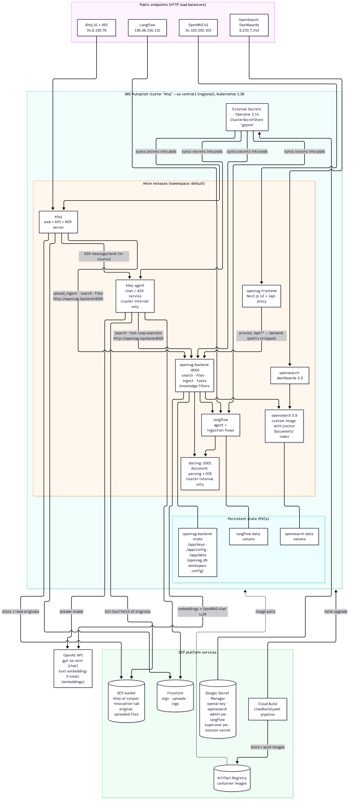
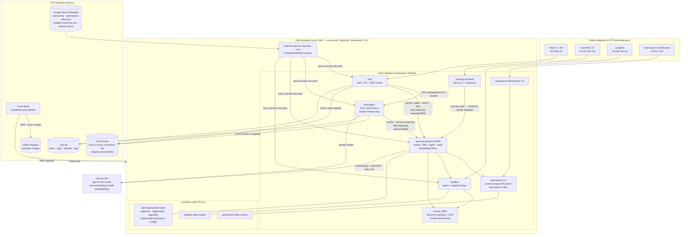

# Khoj — Deployment Diagram (OpenRAG on GKE)

*Nov 3, 2026 · GCP project `innovation-lab-2026` · identity/authentication intentionally omitted per request — this diagram covers the OpenRAG deployment and how Khoj consumes it.*

## Diagram

## Reading the diagram

- **One cluster, two products.** GKE Autopilot runs the Khoj services (`khoj`, `khoj-agent`)
  and the full OpenRAG stack side by side as separate Helm releases in the same namespace.
  Khoj treats OpenRAG as an internal service: all Khoj→OpenRAG traffic stays in-cluster at
  `http://openrag-backend:8000`.
- **Route contract (learned the hard way).** The OpenRAG backend serves **unprefixed** routes
  (`/search`, `/files`, `/router/upload_ingest`, `/tasks/...`, `/knowledge-filter`). The
  `/api/*` prefix exists only on the frontend's proxy, which strips it. Anything calling the
  backend with `/api/*` gets a 404.
- **OpenRAG internals.** The backend orchestrates: Docling parses documents (OCR on),
  Langflow runs the ingestion and agent flows, OpenSearch (custom 3.8 image — the stock
  image lacks the jvector engine the index requires) holds the `documents` index. Backend
  state that upstream keeps on local disk (keys, config, `openrag.db`) lives on PVCs so pod
  restarts don't wipe configuration.
- **Kubernetes gotcha baked into the charts.** Every workload sets
  `enableServiceLinks: false`. With service links on, Kubernetes injects
  `OPENRAG_BACKEND_PORT`-style variables that collide with the apps' own configuration
  (this caused both a broken OIDC discovery URL and search 401s during bring-up).
- **Secrets.** Nothing sensitive is in Helm values or git. External Secrets Operator syncs
  from Google Secret Manager (see the production deployment guide for the full setup).
- **Delivery.** Cloud Build builds the Khoj images (and the patched OpenRAG backend image),
  pushes them to Artifact Registry in-step, then runs `helm upgrade` for both Khoj releases
  using a static-token kubeconfig (the stock helm image has no `gke-gcloud-auth-plugin`).
  Deploys are currently submitted manually; wiring the GitHub trigger needs one console
  OAuth step.
- **Exposure.** Four public HTTP load-balancer IPs (Khoj, OpenRAG UI, Langflow, Dashboards).
  The agent and Docling are cluster-internal only. Production hardening (domain + HTTPS)
  is covered in the deployment guide.
