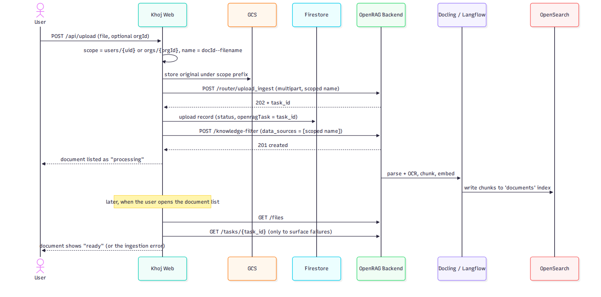
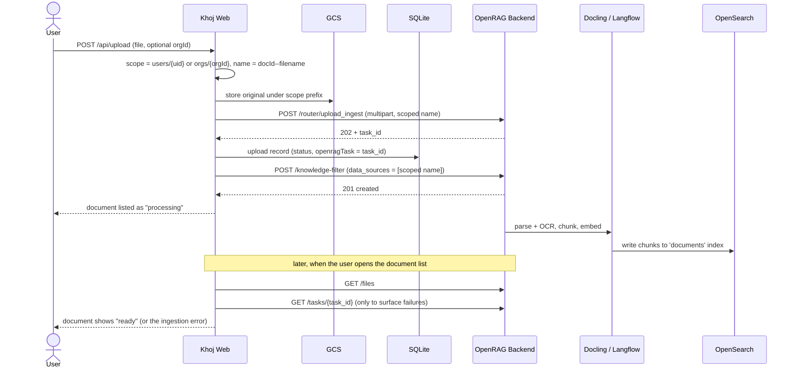
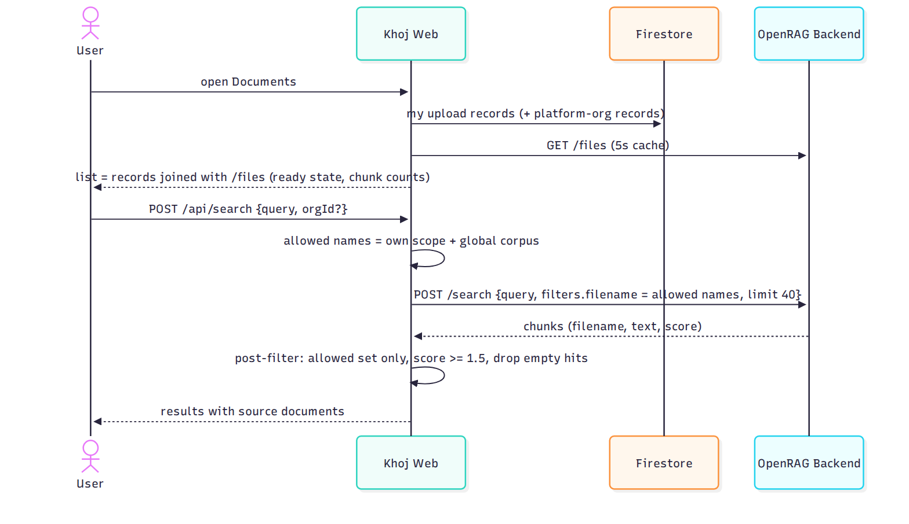
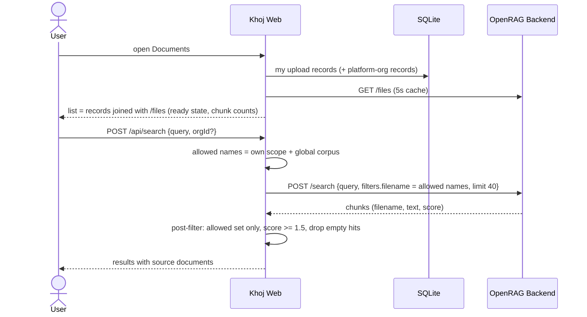
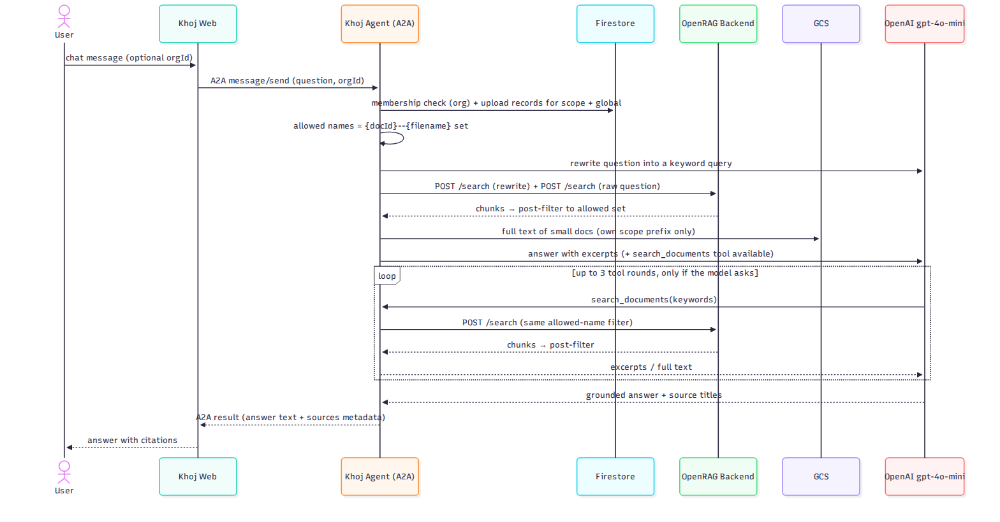
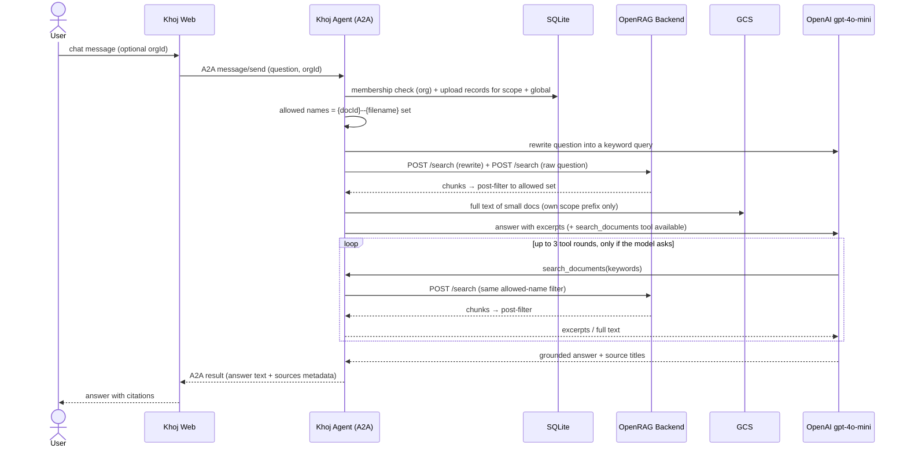

# Khoj — Which OpenRAG APIs Are Used, and Where

*Nov 3, 2026 · grounded in the code at build `3eed4af` (repo `khoj-ai`). All calls go to the
OpenRAG backend in-cluster at `OPENRAG_URL` (default `http://openrag-backend:8000`) on its
**unprefixed** routes — the backend serves no `/api/*` paths; that prefix exists only on
OpenRAG's own frontend proxy.*

## The complete list — 7 endpoints, 2 callers

| # | OpenRAG API | Called from (code) | Used for |
|---|---|---|---|
| 1 | `POST /router/upload_ingest` | Web — `upload()` in `app/main.py` | Trigger ingestion of an uploaded file |
| 2 | `GET /tasks/{task_id}` | Web — `_openrag_task_error()` in `app/main.py` | Detect a failed ingestion so the UI can show it |
| 3 | `POST /knowledge-filter` | Web — `_create_knowledge_filter()` in `app/main.py` | Register the document in OpenRAG's Knowledge tab |
| 4 | `GET /files` | Web — `_openrag_files()` in `app/main.py` | Document list + readiness (which files are indexed, chunk counts) |
| 5 | `POST /search` | Web — `_openrag_search()` in `app/main.py`; Agent — `_openrag_chunks()` in `agent/main.py` | All retrieval: Khoj search UI **and** every chat retrieval (seed + tool loop) |
| 6 | `POST /documents/delete-by-filename` | Web — `delete_document()` in `app/main.py` | Delete a document's indexed chunks (UI Delete button) |
| 7 | `POST /knowledge-filter/search` + `DELETE /knowledge-filter/{id}` | Web — `_delete_knowledge_filter()` in `app/main.py` | Remove the document's Knowledge-tab filter on delete (best-effort) |

That is the entire integration surface. Everything else Khoj does — orgs, memberships,
invites, upload records, chat history, metrics — lives in SQLite + the originals storage backend and never touches
OpenRAG.

## Per stage of the document lifecycle

### 1. Ingestion (upload)

```
POST /router/upload_ingest
multipart form field "file" = the file bytes, named "{docId}--{filename}"
→ 200/202, response JSON carries "task_id"
```

- Before this call, the web app stores the original in GCS under the scope prefix
  (`users/{uid}/…` or `orgs/{orgId}/…`) and computes the scoped OpenRAG name.
- The returned `task_id` is stored on the SQLite upload record (`openragTask`).
- Ingestion itself (parse → chunk → embed → index) runs asynchronously inside OpenRAG:
  Docling parses, a Langflow flow chunks/embeds, OpenSearch stores the chunks.
- Right after triggering ingestion, the web app also calls:

```
POST /knowledge-filter        → 201
{ "name": "<filename without extension>",
  "description": "Uploaded via Khoj: <filename>",
  "queryData": { "query": "",
                 "filters": { "data_sources": ["{docId}--{filename}"],
                              "document_types": [], "owners": [], "connector_types": [] },
                 "limit": <n>, "scoreThreshold": 0 },
  "color": "green", "icon": "file" }
```

Best-effort (failures are swallowed): this is what makes the document appear in OpenRAG's
Knowledge tab, which lists filters, not files.

### 2. List documents & readiness

```
GET /files
→ { "files": [ { "filename": "{docId}--{filename}", "chunks": <n>, "indexed_time": … }, … ] }
```

- The web app fetches the full file list (cached for 5 seconds, shared across requests) and
  joins it with the caller's SQLite upload records by the scoped filename.
- A document shows as **ready** when its name is present in `/files`; chunk counts and
  indexed time come from this response.
- Failure surfacing: for records that carry a task id, `_openrag_task_error()` calls
  `GET /tasks/{task_id}` (with a `/v1/tasks/{task_id}` fallback probe). If the task status is
  failed/error, the error text is attached to the document in the list instead of the
  document silently sitting in "processing" forever.

### 3. Search (Khoj search box)

```
POST /search
{ "query": "<user query>",
  "filters": { "filename": [ "<allowed name>", … ] },
  "limit": 40 }
→ [ { "filename": …, "text": …, "score": … }, … ]   (chunk list)
```

- `filters.filename` is the caller's **allowed-name set** (own scope + global corpus) — this
  is the server-side half of the isolation boundary.
- Khoj then post-filters: drops chunks below the relevance floor (`KHOJ_MIN_SCORE`, default
  1.5), drops empty-text hits, and drops anything not in the allowed set.

### 4. Chat

Chat does **not** use OpenRAG's chat endpoint (see "Deliberately not used"). The agent
implements the answer loop itself, and its only OpenRAG call is the same search API:

```
POST /search        (agent: _openrag_chunks, limit 30)
{ "query": "<keyword query>", "filters": { "filename": [ "<allowed name>", … ] }, "limit": 30 }
```

- Called once for the rewritten query and once for the raw question (seeded retrieval,
  results merged), then again inside the `search_documents` tool — up to 3 tool rounds —
  each time with the identical allowed-name set rebuilt for that call.
- Full text for small documents (≤20k chars) is fetched from **GCS**, not from OpenRAG.
- The answer model (OpenAI gpt-4o-mini) is called directly by the agent; OpenRAG is not
  involved in generation.

### 5. Deletion

The product does not expose document deletion yet, so **no delete call exists in the Khoj
code**. Operationally (e.g., the Nov 3 clean slate), documents were removed with OpenRAG's
own endpoint from an operator shell:

```
POST /documents/delete-by-filename   { "filename": "{docId}--{filename}" }
```

Wiring this into the Khoj UI (plus deleting the stored original and the SQLite record) is a
known follow-up.

## Sequence diagrams

### Ingestion





### Search and list





### Chat





## Deliberately not used

| OpenRAG API | Why not |
|---|---|
| `POST /chat` (and its streaming variant) | Khoj runs its own answer loop (ADR-005) so the corpus filter is enforced inside every search the model triggers; OpenRAG's chat searches the whole index with no per-tenant boundary |
| `GET /knowledge-filter/search` | Khoj search goes through `/search` with an explicit filename filter; filter-scoped search is the OpenRAG UI's path |
| `/v1/*` API-key routes | Machine callers use Khoj's own MCP/A2A surface instead; the single exception is the `/v1/tasks/{id}` fallback probe in `_openrag_task_error()` |
| Connector / cloud-picker APIs | Uploads arrive through the Khoj UI only in the POC |
