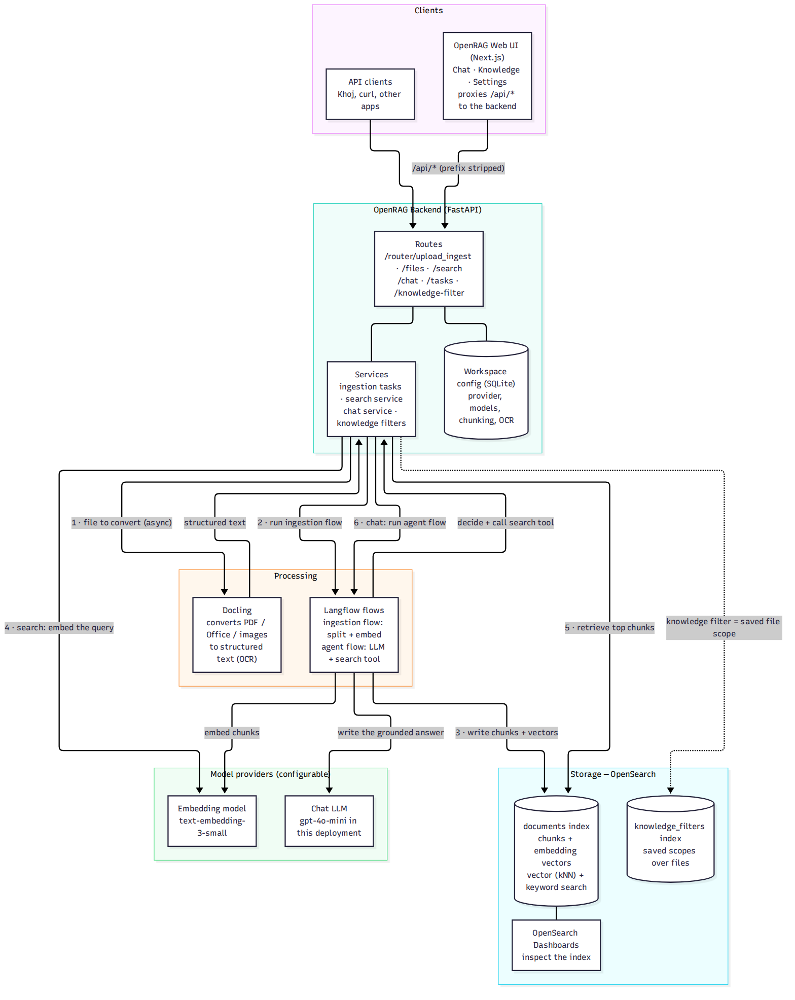
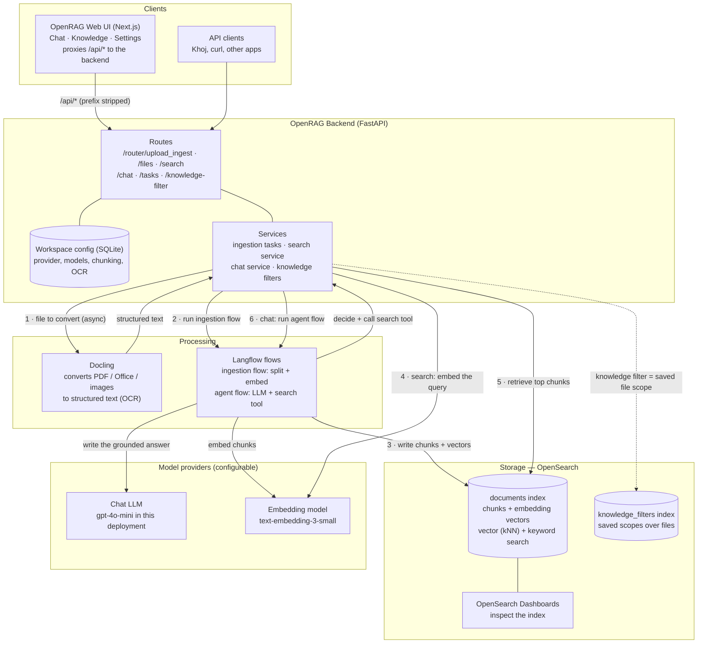

# How OpenRAG Works

*The engine on its own — components and the two flows (ingestion and asking) that do all the
work. Based on the upstream `langflow-ai/openrag` source and the GKE deployment verified
Nov 3, 2026.*

## Diagram

## The pieces

| Piece | What it does |
|---|---|
| **Web UI** | Next.js app with Chat, Knowledge and Settings pages. It owns no logic of its own for data: every call goes through its `/api/*` proxy to the backend, which strips the prefix |
| **Backend** | FastAPI service holding all routes and orchestration. Configuration (provider, chat/embedding models, chunk size 1000 / overlap 200, OCR on/off) lives in a small SQLite database; long work (ingestion) runs as tracked **tasks** |
| **Docling** | The parser. Converts PDFs, Office files and images into structured text/markdown, with OCR for scans. Conversion is asynchronous — the backend submits and polls |
| **Langflow** | The flow engine. Two flows matter: the **ingestion flow** (split text into chunks, embed them) and the **agent flow** (the chat brain: an LLM equipped with a search tool). Flows are stored in Langflow's own database and are *locked* against casual editing |
| **OpenSearch** | The store and the retriever. The `documents` index holds every chunk's text plus its embedding vector, and answers both vector (kNN, jvector engine) and keyword queries — the returned chunk score blends the two. A second index holds **knowledge filters** |
| **Providers** | Pluggable model backends (OpenAI, Anthropic, Ollama, WatsonX, custom endpoints). One provider supplies the chat LLM, another (or the same) the embedding model; a health endpoint validates both |

## Flow 1 — ingestion (a file becomes searchable)

1. A file arrives at `POST /router/upload_ingest`; the backend creates an ingestion **task**
   and returns its id immediately.
2. The backend hands the file to **Docling**, which converts it to structured text (OCR if
   enabled) — asynchronously, polled to completion.
3. The **Langflow ingestion flow** splits the text into chunks (configured size/overlap) and
   calls the **embedding model** to vectorize each chunk.
4. Chunks + vectors are written into the OpenSearch `documents` index under the file's name.
5. The task completes; the file now appears in `GET /files` with its chunk count and indexed
   time, and — if a knowledge filter names it — in the Knowledge tab.

## Flow 2 — asking (search and chat)

**Search** (`POST /search`) is the atomic operation everything else is built on:
the query is embedded with the same embedding model, OpenSearch retrieves the top chunks by
blended vector + keyword score, and the chunks come back with their scores and source
filenames. Optional filters narrow the search — most importantly by filename, or by a
**knowledge filter** (a named, saved set of files: "chat only over these documents").

**Chat** (`POST /chat`) wraps search in an agent loop:
1. The backend's chat service starts the **Langflow agent flow** with the question.
2. The **LLM** reads the question and calls its **search tool** — one or more `/search`
   retrievals, scoped by the selected knowledge filter if there is one.
3. Retrieved chunks are handed back to the LLM, which writes a **grounded answer** citing
   the source documents; the answer streams back to the UI and the conversation is saved.

That split — a dumb, reliable `/search` underneath a smart, iterative chat loop — is the
whole architecture. Anything that only needs retrieval (like Khoj) can live on `/search`
alone; anything that needs answers uses the agent flow on top of it.

## Where everything is stored

OpenRAG has no separate metadata database for files. The inventory is *derived from the
index itself*; everything else lives in exactly three places.

| What | Where | Notes |
|---|---|---|
| **Chunks + vectors** | OpenSearch `documents` index (StatefulSet, persistent volume) | One index document per chunk: chunk text + embedding vector (kNN) + its metadata |
| **Per-chunk metadata** | On each chunk document in `documents` | Filename and indexed timestamp are the load-bearing fields — scoping, filtering and freshness all read them |
| **The list of files** | *Computed* from `documents` by `GET /files` | The backend aggregates chunks by filename → per file: chunk count + indexed time (latest chunk timestamp). Delete the chunks and the "file" disappears — there is no file row anywhere |
| **Knowledge filters** | OpenSearch `knowledge_filters` index | A filter = name + saved query scope (`data_sources` = filenames, types, owners) |
| **Workspace config** | Backend SQLite (`openrag.db` on the backend's persistent volume) | Provider + model choices, chunk size/overlap, OCR flag, onboarding state — the `workspace_config` table, one row per section |
| **Flows** | Langflow's own database | Ingestion flow + agent flow; stored flows are locked against editing |
| **Original files** | **Nowhere, in OpenRAG** | Parsed → indexed → discarded. (In the Khoj stack, Khoj keeps originals — see below) |

### The Khoj side of the same picture

Because OpenRAG keeps no file records of its own, Khoj keeps the system of record:

| What | Where |
|---|---|
| **File metadata** (ownership + scope) | Firestore `file_uploads`: `{docId, scopeKey, uid, orgId, filename, openragTask, uploadedAt}` — who owns it, personal vs org vs global, when it was uploaded, and the OpenRAG ingestion task id |
| **Original files** | GCS bucket `khoj-ai-corpus-innovation-lab` — the re-indexing source if the OpenSearch volume is ever lost |
| **Document list in the Khoj UI** | Firestore records **joined live** with OpenRAG `GET /files` — Firestore says what exists and whose it is; OpenRAG says whether it is indexed, how many chunks, and when |
| **Orgs, members, invites, branding** | Firestore collections (`orgs`, `members`, `invites`) |
| **Search / chat / upload log** | Firestore `search_logs` — the source of the Super Admin Q&A view and metrics |
| **Ingestion time (admin matrix)** | Computed, not stored: OpenRAG indexed time (from `/files`) minus Khoj's `uploadedAt` |
